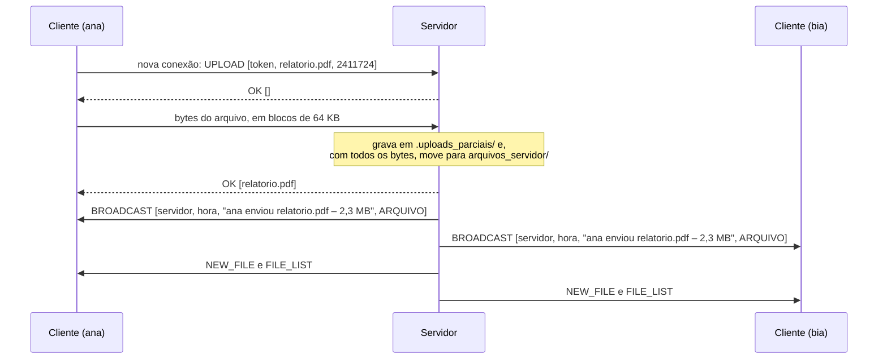

# Mini Servidor de Chat (TCP)

Chat em grupo com compartilhamento de arquivos, comunicando **só por sockets TCP**. Vários
clientes gráficos (Swing) se conectam ao servidor, conversam em tempo real, enviam arquivos de
qualquer extensão e baixam os arquivos da pasta central. A lista de usuários e a de arquivos se
atualizam sozinhas, e o servidor grava tudo em `log_servidor.txt`.

## Como rodar

**No IntelliJ:** abra esta pasta e use as configurações de execução **Servidor** e **Cliente**
(canto superior direito). O Cliente pode ser aberto várias vezes ao mesmo tempo. Se o IntelliJ
perguntar se quer parar o que já está rodando, vá em *Edit Configurations → Cliente → Modify
options* e marque **Allow multiple instances**.

**Pelo .jar** (Java 17 ou mais novo):

```bash
./build.sh
java -jar dist/MiniServidorChat.jar servidor
java -jar dist/MiniServidorChat.jar cliente
```

Com duplo clique no `.jar`, ele pergunta se é servidor ou cliente. O servidor aceita
`--porta N` e `--sem-janela` (para rodar só no terminal).

## Apresentação em duas máquinas

1. Ligue as máquinas na mesma rede (mesmo Wi-Fi ou cabo).
2. Abra o **servidor** em uma delas. A janela mostra o IP a usar, por exemplo
   `Nos clientes, use o IP 192.168.0.10 e a porta 5050`.
3. Abra um **cliente** em cada máquina (a do servidor também pode ter um), digite esse IP, um
   nickname e clique em **Conectar**.
4. **Firewall:** na primeira execução, o Windows pergunta se libera o Java. Marque **Redes
   privadas**. No macOS, se o firewall estiver ligado, clique em **Permitir**.
5. Redes de faculdade, de visitante e alguns roteadores bloqueiam a comunicação entre aparelhos.
   Se não conectar, use o roteador de casa ou o hotspot do celular.

A porta padrão é a **5050**, porque no macOS a 5000 é ocupada pelo AirPlay.

Arquivos gerados pelo servidor, na pasta de onde ele é executado:

- `arquivos_servidor/`: a pasta central (os autores ficam em `.autores.properties`, dentro dela).
- `.uploads_parciais/`: uploads em andamento; é limpa ao iniciar.
- `log_servidor.txt`: `[AAAA-MM-DD HH:MM:SS] [IP:porta] [nickname] [OPERAÇÃO] [STATUS] detalhes`.
  O arquivo só cresce; apague-o antes da gravação para ficar só com o que aparece no vídeo.

## Estrutura

```
src/minichat/
├── Iniciar.java                  lançador do .jar (servidor ou cliente)
├── comum/                        usado pelos dois lados
│   ├── Protocolo.java            comandos, códigos de erro, porta, buffer e copiarEmBlocos()
│   ├── Mensagem.java             formato das mensagens (escrever e ler do socket)
│   ├── InfoArquivo.java          nome, tamanho e autor de um arquivo
│   └── ErroProtocolo.java        resposta ERROR transformada em exceção
├── servidor/
│   ├── ServidorChat.java         accept(), usuários conectados e broadcast
│   ├── AtendimentoCliente.java   thread de cada conexão; canal de chat
│   ├── ClienteConectado.java     fila de saída e thread escritora de cada cliente
│   ├── TransferenciaArquivos.java  upload e download (canal de arquivo)
│   ├── RepositorioArquivos.java  pasta central e nomes repetidos
│   ├── LogServidor.java          log_servidor.txt
│   └── JanelaServidor.java       janela do servidor
└── cliente/
    ├── ClienteChat.java          main do cliente
    ├── ConexaoChat.java          canal de chat: LOGIN, recepção, envio e PING
    ├── TransferenciaCliente.java upload e download (canal de arquivo)
    ├── OuvinteChat.java          o que chega do servidor
    └── JanelaCliente.java        interface gráfica
```

### Threads

| Lado | Thread | O que faz |
|---|---|---|
| Servidor | principal | `accept()` em loop; cria uma `AtendimentoCliente` por conexão |
| Servidor | `AtendimentoCliente` (uma por conexão) | no canal de chat, lê os comandos do cliente; no canal de arquivo, faz o upload ou o download |
| Servidor | escritora (uma por cliente no chat) | esvazia a fila de saída do cliente e escreve no socket |
| Servidor | Swing (EDT) | atualiza a janela do servidor |
| Cliente | Swing (EDT) | interface; nunca espera a rede |
| Cliente | receptora | lê o canal de chat e repassa à tela com `invokeLater` |
| Cliente | envios | escreve no canal de chat: mensagens, `PING` a cada 5 s e `LOGOUT` |
| Cliente | `SwingWorker` | conectar, upload e download, com a barra de progresso |

## Protocolo

O cliente abre uma conexão de **chat** (a primeira mensagem é `LOGIN`) e, para cada arquivo, uma
conexão de **arquivo** separada, na mesma porta (a primeira mensagem é `UPLOAD` ou `DOWNLOAD`).

Cada mensagem é escrita com `DataOutputStream`: `writeUTF(comando)`, `writeInt(quantidade de
campos)` e um `writeUTF` por campo. O `writeUTF` põe 2 bytes com o tamanho antes do texto, então
quem lê sabe onde cada campo termina. Nos exemplos, os campos estão entre colchetes.

| Comando | Sentido | Campos | Exemplo | Resposta |
|---|---|---|---|---|
| LOGIN | C→S | nickname | `LOGIN ["ana"]` | `OK ["<token>"]` ou `ERROR ["409", "o nickname \"ana\" já está em uso"]` |
| MSG | C→S | texto | `MSG ["oi pessoal"]` | BROADCAST a todos |
| BROADCAST | S→C | remetente, data/hora, texto, categoria | `BROADCAST ["ana", "2026-11-21 19:04:16", "oi pessoal", "CHAT"]` | — |
| USERS | S→C | nicknames | `USERS ["ana", "bia"]` | — |
| UPLOAD | C→S | token, nome, tamanho em bytes; depois os bytes | `UPLOAD ["<token>", "relatorio.pdf", "2411724"]` + 2411724 bytes | `OK []` antes dos bytes e `OK ["relatorio.pdf"]` no fim, ou ERROR |
| NEW_FILE | S→C | nome, tamanho, autor | `NEW_FILE ["relatorio.pdf", "2411724", "ana"]` | — |
| FILE_LIST | S→C | nome, tamanho e autor de cada arquivo | `FILE_LIST ["relatorio.pdf", "2411724", "ana", "foto.jpg", "80233", "bia"]` | — |
| DOWNLOAD | C→S | token, nome | `DOWNLOAD ["<token>", "relatorio.pdf"]` | `OK ["2411724"]` + 2411724 bytes, ou `ERROR ["404", "arquivo inexistente: relatorio.pdf"]` |
| LOGOUT | C→S | (vazio) | `LOGOUT []` | USERS e aviso de saída a todos |
| ERROR | ambos | código, mensagem | `ERROR ["404", "arquivo inexistente: x.pdf"]` | — |
| PING / PONG | C→S / S→C | (vazio) | `PING []` | `PONG []` |

- **Categoria do BROADCAST:** `CHAT` (mensagem de alguém), `SISTEMA` (entrou, saiu, caiu) ou
  `ARQUIVO` (novo arquivo, destacado no cliente).
- **Token:** o servidor devolve um token no `OK` do LOGIN. As conexões de arquivo mandam esse
  token para o servidor saber quem está enviando ou baixando.
- **Códigos de erro:** 400 (pedido inválido), 401 (sem login), 404 (arquivo inexistente),
  409 (nickname em uso), 500 (erro interno), 507 (sem espaço).

### Upload



## Decisões de projeto

| Decisão | Escolha | Por quê |
|---|---|---|
| Concorrência | Uma thread por conexão e, para cada cliente no chat, uma fila de saída com uma thread escritora | O broadcast só coloca a mensagem nas filas, então um cliente lento não atrasa os outros |
| Delimitação das mensagens | Prefixo de tamanho: `writeUTF` em cada campo e `writeInt` com a quantidade de campos | Mesmo padrão das aulas; o receptor sabe exatamente onde cada mensagem termina |
| Fim do arquivo | O tamanho em bytes vai no UPLOAD e no OK do DOWNLOAD, antes dos bytes | O receptor lê exatamente essa quantidade e sabe onde o arquivo acaba |
| Canal de arquivos | Uma conexão TCP separada por transferência, na mesma porta | O canal de chat nunca carrega bytes de arquivo e continua livre durante uploads longos |
| Tamanho do buffer | 64 KB | Poucas chamadas de sistema por arquivo e barra de progresso fluida, sem carregar o arquivo inteiro na memória |
| Nickname repetido | Recusar (`ERROR 409`) | O nickname identifica a pessoa no chat; o cliente avisa e deixa escolher outro |
| Arquivo com nome repetido | Renomear (`relatorio (1).pdf`), sem diferenciar maiúsculas | Ninguém perde arquivo; no Windows e no macOS `Foto.jpg` e `foto.jpg` são o mesmo arquivo |
| Estruturas compartilhadas | Usuários em `ConcurrentHashMap` (`putIfAbsent` reserva o nickname); entradas, saídas e broadcasts em métodos `synchronized`; repositório e log `synchronized` | Dois logins ou uploads simultâneos não se atropelam, e todos recebem as listas na mesma ordem |
| Transferência interrompida | O upload vai para `.uploads_parciais/` e só entra na pasta central completo; o download grava `.parcial` no cliente e só renomeia no fim | Um arquivo incompleto nunca aparece na lista nem fica no destino |
| Queda de conexão | Fim do stream ou erro no socket, mais `PING` a cada 5 s; 15 s sem nada chegar = conexão perdida | Fechar o programa avisa na hora; o PING detecta queda de rede, que não avisa ninguém |
| Cliente que para de ler | Fila de até 10.000 mensagens; passou disso, é desconectado | Rajadas cabem com folga, e a memória do servidor não cresce sem limite |
